# Variables and types

Variables hold the values your program operates on.

## In practice

```java
int count = 3;
String name = "Ada";
```

Continue with [loops](loops.md); the  shows
the lifecycle of a value. See the [exercises](README.md#exercises) for practice.
